# Kitchinox (Kitchen Planner) - Architecture Globale & Guide de Référence

Ce document constitue la référence exhaustive de l'application **Kitchinox (Kitchen Planner)**. Il a été conçu pour permettre à un développeur ou un modèle d'IA (tel que Google Gemini ou Claude) de comprendre immédiatement le fonctionnement, les règles métier, la structure du code et la façon de contribuer efficacement au projet sans introduire de régressions.

---

## 1. Vision Générale & Objectifs

**Kitchinox** est une solution logicielle tout-en-un professionnelle destinée aux cuisinistes, agenceurs d'intérieur et menuisiers. Elle couvre toute la chaîne de valeur :

1. **Conception d'Espace & Implantation 2D/3D** :
   - Dessin des murs, pièces complexes, portes, fenêtres, contraintes techniques (eau, gaz, prises, évacuations).
   - Implantation ergonomique de cuisines, salles de bain, dressings, buanderies et meubles TV.
   - Rendu en temps réel : 2D vue de dessus (Plan), 2D vue de face (Élévation), 2.5D axonométrique et **3D temps réel réaliste (Three.js WebGL)** avec textures et éclairage.
2. **Mode Art (Atelier CAO & Fabrication Paramétrique de Meubles)** :
   - Modeleur CAO façon SketchUp : esquisse 2D (lignes orthogonales à 90°, rectangles, polygones, cercles, arcs), magnétisme intelligent.
   - Extrusion 3D (Pousser / Tirer) vers des feuilles d'épaisseur paramétrable (18 mm, 16 mm, 19 mm, 6 mm, etc.).
   - Liaisons d'assemblage (`EdgeLink` / `ArtRelations`) et moteur d'usinage automatique (trous de tourillons, vis biaises, charnières invisibles 35 mm, coulisses de tiroirs, pieds de meuble, plinthes, bandes de chant et rainures).
3. **Calepinage & Optimisation de Découpe (Nesting / Guillotine)** :
   - Optimisation de sciage à panneaux (coupes guillotine répétées) et CNC nesting libre.
   - Prise en compte du trait de scie (*saw kerf*), du rognage de rive (*edge trim*) et du sens du fil du bois (*grain direction*).
   - Gestion individualisée des formats et épaisseurs des feuilles selon 3 catégories clés :
     - **Caissons** (ex. Latté meuble 2100 × 2020 × 18 mm).
     - **Façades** (ex. High Gloss MDF 2800 × 1220 × 18 mm).
     - **Fonds / Derrières** (ex. HDF / MDF 6 mm).
4. **Chiffrage, Devis & BOM (Bill of Materials)** :
   - Calcul des besoins en panneaux complets, surfaces nettes/brutes, linéaires de chants.
   - Quincaillerie automatique par marques (Blum, Hettich, DTC, Gola...) et prix publics/fournisseurs.
   - Devis client et bon de commande atelier exportables en PDF et Excel.
5. **Exports Industriels & Production d'Atelier** :
   - **Export SketchCut (`.sct`) sélectif** : dialogue modal permettant d'exporter 1, 2 ou 3 fichiers selon les panneaux choisis (Caissons, Façades, Fonds).
   - **Dossier Technique PDF complet** : plans de pose cotés, schémas de découpe couleur, fiches de perçage et étiquettes avec QR Code.
   - **Sauvegarde et Échange** : format propriétaire `.kin` (archive JSON).
6. **Multiplateforme & Internationalisation** :
   - Multiplateforme : Web (Chrome, Edge, Safari), Desktop (Windows, macOS, Linux), Mobile (Android, iOS).
   - Pipeline CI/CD GitHub Actions (`.github/workflows/ios.yml`) générant l'application iOS (`Kitchinox.ipa`).
   - Multilingue : Français (FR), Anglais (EN), Arabe (AR avec support RTL et typographie Noto Sans Arabic).

---

## 2. Pile Technologique & Dépendances

- **Framework principal** : Flutter 3 (Dart 3.12+).
- **Rendu 3D WebGL** : Three.js via `assets/web3d/` et `web/three_view.js` (rendu interactif PBR, éclairage ambiant/directionnel, capture de capture perspective haute définition `capturePng()`).
- **Génération documentaire** :
  - `pdf` (3.13.1) & `printing` : génération vectorielle directe des plans, devis et étiquettes.
  - `archive` (4.0.0) : compression des formats `.kin` et packaging.
- **Gestion d'état** : Architecture réactive basée sur `ChangeNotifier` (`AppState`) et des modèles de domaine purs découplés de l'UI.
- **Polices embarquées** : `Plus Jakarta Sans` (Latin), `Noto Sans Arabic` (Arabe).

---

## 3. Structure des Dossiers & Rôles des Fichiers

### 3.1 Répertoire `lib/engine/` (Moteur Métier Pur - Zéro Dépendance UI)
Le moteur métier est totalement indépendant de Flutter (`dart:ui` et `package:flutter` ne doivent pas y être importés, sauf exceptions purement typologiques). Il est 100% testable par tests unitaires.

| Fichier | Rôle Métier |
|---|---|
| `project.dart` | Racine du modèle de données (`Project`, `KitchenStyle`, `RoomShape`, `ClientInfo`, etc.). |
| `layout_engine.dart` | Algorithme de positionnement des caissons sur les murs, alignement, contiguïté, collisions. |
| `catalog.dart` | Parseur et référentiel des caissons standards (bas, hauts, colonnes, angles, casseroliers, armoires). |
| `cutting.dart` | Moteur de calepinage / nesting 2D : algorithmes guillotine et libre, gestion des formats par matière (`sheetDimensionsFor`), chutes et rendements. |
| `materials.dart` | Calcul des surfaces de panneaux, linéaires de chants, besoins bruts/nets et estimation financière. |
| `quote.dart` & `bom.dart` | Nomenclature industrielle détaillée (Bill of Materials), consommables, quincaillerie et marges. |
| `end_panels.dart` | Détection automatique des joues et côtés visibles exposés nécessitant un habillage de finition. |
| `corners.dart` & `clearance.dart` | Règles d'angles, filoirs d'angle et distances de sécurité (cuisson, évier, passages). |
| `front_layout.dart` | Découpage des façades (tiroirs, portes simples, doubles portes, niches, relevables). |
| `fixes.dart` | Moteur d'audit et de corrections automatiques des incohérences d'implantation. |
| `art.dart` | Modèle de données du Mode Art (`ArtProject`, `ArtPanel`, `ArtFace`, `ArtHole`, `EdgeLink`, `ArtRole`). |
| `art_cad.dart` | Moteur géométrique 2D/3D pour le dessin CAO (lignes, rectangles, cercles, arcs, magnétisme, intersection). |
| `art_relations.dart` | Solveur topologique des liaisons de chants (`solveAssembly`, calcul automatique des positions 3D). |
| `art_machining.dart` | Moteur d'usinage automatique (détection des intersections, pose de vis, tourillons, charnières, pieds). |
| `art_recipes.dart` | Recettes paramétriques de meubles sur mesure (caisson 1 porte, 2 portes, casserolier, etc.). |
| `art_sheet_cabinet.dart` | Création de meubles complets découpés directement à partir d'une feuille standard. |
| `furniture.dart` | Univers hors-cuisine (salle de bain, dressing en L/U, meuble TV, buanderie). |
| `furniture_accessories.dart` | Accessoires de meubles (paniers coulissants, range-épices, porte-pantalons, etc.). |
| `public_prices.dart` & `supplier.dart` | Tarification publique et fournisseurs pour les panneaux et la quincaillerie. |
| `saved_projects.dart` & `kin_format.dart` | Sérialisation, sauvegarde locale et export/import au format `.kin`. |

### 3.2 Répertoire `lib/ui/` (Interface Utilisateur & Rendu)
| Fichier | Rôle UI |
|---|---|
| `app_state.dart` | Contrôleur central réactif (`ChangeNotifier`) orchestrant le projet, les sélections, l'historique Undo/Redo. |
| `home_screen.dart` | Écran principal divisé entre la zone de travail graphique, les panneaux latéraux et la barre d'outils. |
| `canvas_view.dart` | Vue de travail 2D (Plan du dessus et Élévation de face) avec magnétisme et cotation dynamique. |
| `header.dart` & `toolbar.dart` | En-têtes, sélecteur d'univers, modes de vue (Plan, Face, 3D, Débit, Devis, Art) et outils contextuels. |
| `scene3d.dart` | Rendu 2.5D axonométrique/orthographique sur Canvas Flutter pour les machines légères. |
| `view3d_web.dart` / `native.dart` | Passerelle vers le moteur WebGL Three.js (gestion de la caméra orbitale, shaders, matériaux réalistes, capture PNG). |
| `scene_export.dart` | Traducteur de la scène Kitchinox en objets 3D (panneaux, façades, poignées, pieds, électroménager). |
| `art_page.dart` | Atelier du **Mode Art** : interface CAO complète, vue 2D/3D partagée, timeline de montage. |
| `art_cad_toolbar.dart` | Barre d'outils CAO du Mode Art (Dessin, Déplacer, Pivoter, Symétrie, Mètre, Pousser/Tirer, Chants). |
| `art_library.dart` | Bibliothèque de meubles prêts à l'emploi et favoris d'atelier. |
| `project_settings_dialog.dart` | Modal de configuration : client, épaisseurs de caissons/façades, dimensions des 3 types de panneaux, machine de coupe. |
| `sct_export.dart` | Générateur du format SketchCut `.sct` et dialogue d'export sélectif multi-fichiers. |
| `pdf_export.dart` | Génération du dossier complet de plans techniques (vue 3D, plans de face et dessus cotés). |
| `quote_pdf.dart` & `cut_pdf.dart` | Générateurs PDF du devis commercial et du plan de calepinage d'atelier. |
| `stock_page.dart` | Gestion de l'inventaire des panneaux entiers et des chutes réutilisables d'atelier. |
| `i18n.dart` & `i18n_dict.dart` | Moteur de traduction et dictionnaire trilingue (Français, Anglais, Arabe). |

### 3.3 Répertoire `assets/` (Données Métier & Catalogues)
- `assets/catalog.json` : Répertoire de tous les caissons cuisines avec leurs dimensions, codes pièces et accessoires.
- `assets/data/furniture/*.json` : Meubles pour `bain.json`, `dressing.json`, `tv.json`, `buanderie.json`, `interieur.json`.
- `assets/data/appliances.json` : Électroménager standard (fours, plaques, hottes intégrées, éviers, réfrigérateurs).
- `assets/data/hardware.json` & `brands.json` : Charnières, coulisses, vérins et prix par marque (Blum, Grass, Hettich, etc.).
- `assets/data/public_prices.json` : Prix de référence des panneaux (MDF brut, hydrofuge, mélaminé blanc, Latté, High Gloss, Compact).

---

## 4. Les Grands Moteurs Fonctionnels

```mermaid
flowchart TD
    A["Projet Kitchinox (Project)"] --> B["1. Moteur d'Implantation (LayoutEngine)"]
    A --> C["2. Mode Art (CAO & Assemblage)"]
    A --> D["3. Calepinage & Nesting (Cutting)"]
    A --> E["4. Chiffrage & Quincaillerie (BOM & Quote)"]

    B --> B1["Plan 2D & Élévations"]
    B --> B2["Scène 3D Réaliste (Three.js WebGL)"]
    B --> B3["Détection automatique des côtés exposés"]

    C --> C1["Esquisse 2D (Ligne, Rect, Arc, Cercle)"]
    C --> C2["Pousser/Tirer (Extrusion 3D)"]
    C --> C3["Solveur de Liaisons (EdgeLink / ArtRelations)"]
    C --> C4["Usinage auto (Vis, Tourillons, Charnières)"]

    D --> D1["Formats propres (Caissons / Façades / Fonds)"]
    D --> D2["Optimisation Guillotine & CNC Nesting"]
    D --> D3["Export sélectif SketchCut (.sct)"]

    E --> E1["Nomenclature détaillée des pièces"]
    E --> E2["Quincaillerie automatique par marque"]
    E --> E3["Dossier PDF & Export Excel"]
```



---

## 5. Règles Métier & Invariants Techniques

Lors du développement ou de la modification de code, **les règles suivantes doivent impérativement être respectées** :

### 5.1 Règle des Panneaux et Formats Découpe
- Ne jamais présumer qu'une cuisine est faite d'un seul matériau ou d'un seul format de feuille.
- Il existe **3 flux de panneaux distincts** :
  1. **Caissons / Carcasse** : souvent en Latté ou mélaminé blanc (ex. 2100 × 2020 mm ou 2800 × 2070 mm), épaisseur typique 18 mm.
  2. **Façades** : MDF laqué, stratifié ou High Gloss (ex. 2800 × 1220 mm), épaisseur 18 mm ou 19 mm.
  3. **Fonds / Derrières** : HDF ou MDF mince (ex. 2440 × 1220 mm), épaisseur 6 mm ou 3 mm.
- Toute modification dans `lib/engine/cutting.dart` doit utiliser `cs.sheetDimensionsFor(material)` pour garantir les dimensions exactes de chaque type de panneau.

### 5.2 Habillage des Côtés Visibles (Joues de Colonnes & Meubles Bas)
- Lorsqu'une colonne haute est adjacente à un meuble bas ou à une zone de crédence, son flanc supérieur est visible.
- L'algorithme dans `lib/ui/scene_export.dart` inspecte automatiquement la mitoyenneté (`leftExposed` / `rightExposed`). Si le côté est exposé, il prend la matière de finition `endPanelFinish` (ou la façade correspondante) au lieu de rester en caisson blanc brut.

### 5.3 Moteur du Mode Art (Règles Mathématiques et Topologiques)
- Le Mode Art fonctionne selon le principe fondamental : **Un meuble = des pièces + des relations**.
- Une pièce est définie par sa boîte englobante locale (`w`, `h`, `d`), son rôle (`ArtRole`) et son épaisseur.
- Les liaisons (`EdgeLink`) relient des chants et des faces :
  - `bout` : le chant de la pièce A s'appuie contre la face de la pièce B (ex. étagère contre montant).
  - `applique` : la pièce A couvre le chant de la pièce B (ex. côté posé sur le fond).
  - `articule` : porte en applique devant le meuble (avec charnières, sans perçage de tourillon).
- L'usinage (`art_machining.dart`) est généré dynamiquement à partir des positions relatives :
  - Si deux pièces structurelles se touchent à angle droit : insertion automatique de vis et tourillons de 8 × 30 mm selon les normes d'entraxe (espacement de 32 mm du système 32).
  - Si une porte est détectée : perçage de boîtiers de charnière de diamètre 35 mm à 21,5 mm du bord et 100 mm des extrémités.

### 5.4 Repères Spatiaux
- **X** : Axe horizontal (largeur, de gauche à droite).
- **Y** : Axe vertical (hauteur, du sol vers le plafond).
- **Z** : Axe de profondeur (**Z min = vers l'utilisateur / avant du meuble**, Z max = vers le mur / arrière).
- Les unités du moteur sont systématiquement en **millimètres (mm)**.

---

## 6. Guide de Contribution pour Développeurs & Agents IA

### 6.1 Commandes de Vérification Obligatoires
Avant de soumettre ou committer la moindre modification, toujours exécuter :
```bash
# 1. Analyse statique (doit afficher 0 erreur et 0 avertissement)
dart analyze lib/

# 2. Exécution de la suite de tests unitaires
flutter test test/features_test.dart test/materials_test.dart test/engine_test.dart
```

### 6.2 Conventions de Code & Qualité
- **Internationalisation** : Toutes les chaînes visibles par l'utilisateur doivent utiliser `tr('Texte en français')` via `lib/ui/i18n.dart`. Ne jamais écrire de texte brut non traduit dans les widgets.
- **Séparation UI / Métier** : Ne jamais intégrer de logique de calcul de découpe ou d'assemblage dans les widgets Flutter. Ajouter les méthodes dans les classes de `lib/engine/` et déclencher la notification via `AppState`.
- **Responsive & Contraintes UI** : Toujours anticiper les écrans de taille moyenne (tablettes, ordinateurs portables). Envelopper les bandeaux d'outils horizontaux dans des `SingleChildScrollView(scrollDirection: Axis.horizontal)` et contraindre les largeurs avec `MediaQuery.of(context).size.width` pour éviter les erreurs `RenderFlex overflowed`.

### 6.3 Déploiement & Création de l'application iOS (IPA)
Un push sur la branche `main` du dépôt GitHub déclenche automatiquement la compilation Xcode sur machine macOS et génère le fichier `Kitchinox.ipa` téléchargeable dans les artefacts de build GitHub Actions :
- Dépôt : `https://github.com/issemailboutechiche-1987/kitchinox`
- Workflow : `.github/workflows/ios.yml`
